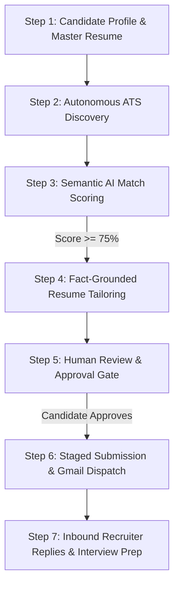

# 🎯 The Job Seeker's Autonomous Career Command Center
### Candidate Handbook & Operating Guide

Welcome to the **Autonomous Job Discovery & Application Automation Platform**.

This platform was built **by engineers, for job seekers and candidates**. It is **not** an enterprise recruiter tool or an HR applicant tracking system. It is your personal, local-first career copilot designed to level the playing field against modern corporate hiring algorithms.

---

## 🧭 Why This Was Built for You (The Job Seeker)

Modern tech hiring is heavily skewed against candidates:
1. **The ATS Black Hole**: When companies post a role, hundreds of generic spam applications flood in within hours. ATS parsers filter candidates out for trivial keyword mismatches.
2. **The "Early Applicant" Window**: Roles receive the vast majority of interview invitations within the first 48 hours of being posted to direct company ATS feeds (Greenhouse, Lever, Ashby, etc.).
3. **Generic Spam Bots**: Unethical bots spray hundreds of low-quality, untailored applications, getting candidate emails blacklisted.
4. **Privacy Violations**: Many cloud job boards scrape and sell candidate resumes, contact information, and current employment details.

### How This Platform Solves It:
- **Direct ATS Ingestion**: Bypasses middlemen job boards by connecting directly to public company ATS career feeds (Ashby, Greenhouse, Lever, SmartRecruiters, Workable).
- **Early-Applicant Detection**: Filters and prioritizes freshly posted vacancies (&le; 48 hours old) so your profile lands on top of the hiring manager's desk.
- **Fact-Grounded Resume Tailoring**: Emphasizes your real, verified projects and accomplishments aligned with the role's specific tech stack—with strict **zero-hallucination guardrails** (no fabricated skills or dates).
- **Human-in-the-Loop Security Gate**: Applications and emails are **staged as drafts** and **never sent without your explicit, one-click manual approval**.
- **Inbound Recruiter Communications Copilot**: When recruiters reply to your applications, the system classifies their intent (interview invites, screening calls, technical assessments), drafts professional responses, and prepares **on-demand interview prep dossiers**.
- **100% Local-First & Private**: Runs locally on your machine. With local Ollama (`qwen2.5:7b` or `llama3.2:3b`), zero personal data leaves your computer.

---

## 🚀 Step-by-Step Candidate Workflow



---

### Step 1: Set Up Your Candidate Profile & Master Resume
Before running discovery, configure your target career criteria:
1. Open the web interface at `http://127.0.0.1:3300/` and navigate to **"My Profile & Resume"**.
2. Enter your candidate details:
   - **Target Job Titles**: e.g. `Staff Software Engineer`, `Senior Backend Engineer`, `SRE / Platform Lead`.
   - **Target Locations**: e.g. `Remote`, `San Francisco, CA`, `New York, NY`.
   - **Minimum Desired Compensation**: e.g. `$180,000`.
   - **Core Skills & Technologies**: e.g. `TypeScript, Node.js, Go, Distributed Systems, Kubernetes, SQLite, PostgreSQL`.
   - **Master Resume**: Paste your master career history or upload your verified CV.
3. Save your profile. The profile is stored locally in your encrypted SQLite database (`./data/job_platform.db`).

---

### Step 2: Autonomous ATS Discovery
The platform automatically polls high-signal company career pages without scraping violations:
- **Supported ATS Integrations**:
  - **Ashby API**: High-growth tech startups and scale-ups.
  - **Greenhouse Public Board API**: Established tech enterprises (e.g., Stripe, Figma, Airbnb).
  - **Lever Public Postings API**: Modern engineering organizations.
  - **SmartRecruiters Public Feed**: Global engineering companies (e.g., Visa).
  - **Workable & Recruitee**: Fast-growing engineering teams worldwide.
  - **RemoteOK & Remotive**: Fully distributed global opportunities.
- **Discovery Modes**:
  - **Automated Background Scheduler**: Runs periodically on a configurable cron schedule (e.g., every 3 hours) with mutual-exclusion locking to prevent duplicate runs.
  - **On-Demand Scan**: Click **"Run Discovery Now"** in the dashboard to immediately refresh openings across all active connectors.

---

### Step 3: Semantic AI Match Scoring
Every discovered job posting is analyzed by the AI engine:
1. **Semantic Requirements Analysis**:
   - Analyzes required years of experience, core tech stack, architectural responsibilities, and seniority.
2. **Candidate Experience Comparison**:
   - Compares the vacancy against your Master Profile skills and accomplishments.
3. **Transparent Scoring Justification**:
   - Generates a 0–100 compatibility score.
   - Outputs clear reasoning: strong matches, missing nice-to-haves, and role fit commentary.
4. **Early Applicant Badge**:
   - Highlights vacancies posted within the last 48 hours to give you the first-mover advantage.

---

### Step 4: Fact-Grounded ATS Resume Tailoring
When a vacancy scores high (&ge; 75%), the system creates a tailored application package:
- **Zero Hallucination Rule**:
  - The AI **only** reorganizes, highlights, and contextualizes your *existing, verified achievements*.
  - It **never** invents companies, positions, technologies you haven't used, or metrics.
- **ATS-Optimized Formatting**:
  - Generates clean, parseable Markdown and professional PDF versions with standard headers, clean typography, and standard chronological experience blocks.
- **Application Note / Cover Letter**:
  - Drafts a concise, professional outreach email tailored to the hiring manager.

---

### Step 5: Human-in-the-Loop Review & Approval Gate
**Nothing is ever sent without your personal sign-off.**
1. Navigate to **"Review & Approvals"** in the dashboard.
2. You will see staged drafts awaiting your review:
   - Inspect the tailored resume and cover letter.
   - Edit any wording directly if you want to tweak a bullet point.
   - Check the destination ATS email address.
3. Choose your action:
   - **Approve & Send**: Submits the application package via your connected Gmail and records the action in `./logs/audit.log`.
   - **Download PDF**: Allows you to manually apply on the company's career page with your tailored ATS resume.
   - **Reject / Archive**: Dismisses the vacancy if you decide not to pursue it.

---

### Step 6: Tracking Submissions & Inbound Recruiter Communications
Once applications are dispatched:
- **Submission History**: Every sent application is tracked in your local SQLite database and optional Google Sheets pipeline tracker.
- **Inbound Recruiter Communications Tab**:
  - Connect your Gmail account via local OAuth (`/api/auth/google/start`).
  - The platform scans for incoming replies from recruiters (e.g. `subject:Application OR subject:Interview`).
  - **AI Intent Classification**:
    - `INTERVIEW_INVITE`: Recruiter invites you to schedule a phone screen or interview.
    - `ASSESSMENT_REQUEST`: Take-home coding test or HackerRank link received.
    - `COMPENSATION_CHECK`: Recruiter asking for salary expectations.
    - `AVAILABILITY_QUERY`: Recruiter asking for open time slots.
    - `REJECTION`: Professional notification to archive the thread.

---

### Step 7: On-Demand Interview Prep & Briefing Dossiers
When you receive an interview invitation:
1. Click **"🎯 On-Demand Interview Prep"** in the Inbound Recruiter Communications tab.
2. The AI generates a customized **Candidate Briefing Dossier**:
   - **Company & Product Deep Dive**: What the company does, business model, and recent public milestones.
   - **Technical Focus Areas**: Expected interview rounds (System Design, Algorithms, Domain Deep Dive, Behavioral).
   - **Strategic Questions to Ask**: Thoughtful questions for you to ask the interviewer about their engineering culture, on-call burden, and roadmap.
   - **STAR Stories Alignment**: Suggests which of your past projects best illustrate the skills required for this specific role.

---

## 🔒 Complete Local Privacy: Zero Cloud Dependency

You can run this platform completely offline without sending any personal data to cloud AI providers:

```bash
# 1. Install Ollama (https://ollama.ai)
ollama pull qwen2.5:7b

# 2. Configure .env for offline local inference
OLLAMA_ENDPOINT=http://127.0.0.1:11434
OLLAMA_MODEL=qwen2.5:7b
CLOUD_DISABLED=true
CLOUD_PROVIDER=none
```

In this mode:
- All resume evaluations and score calculations run entirely on your local GPU/CPU.
- Your resume, career history, and contact details never leave `127.0.0.1`.
- SQLite database is saved on your local disk at `./data/job_platform.db` with strict `0o600` permissions.

---

## 📋 Daily Candidate Checklist

1. **Morning Scan**: Launch the web UI (`http://127.0.0.1:3300`) and click **"Run Discovery Now"** (or let background cron execute).
2. **Review AI Matches**: Check the **"✨ AI Resume Matches"** tab for freshly posted (&le; 48h) roles scoring &ge; 80%.
3. **Approve Staged Drafts**: Go to **"Review & Approvals"**, review the generated ATS resumes, make any personal edits, and click **"Approve & Send"**.
4. **Check Recruiter Replies**: Open **"📬 Inbound Recruiter Replies & Interviews"** to review incoming meeting requests and generate interview prep dossiers.
5. **Interview Ready**: Review your company-specific dossier before your screening call.
